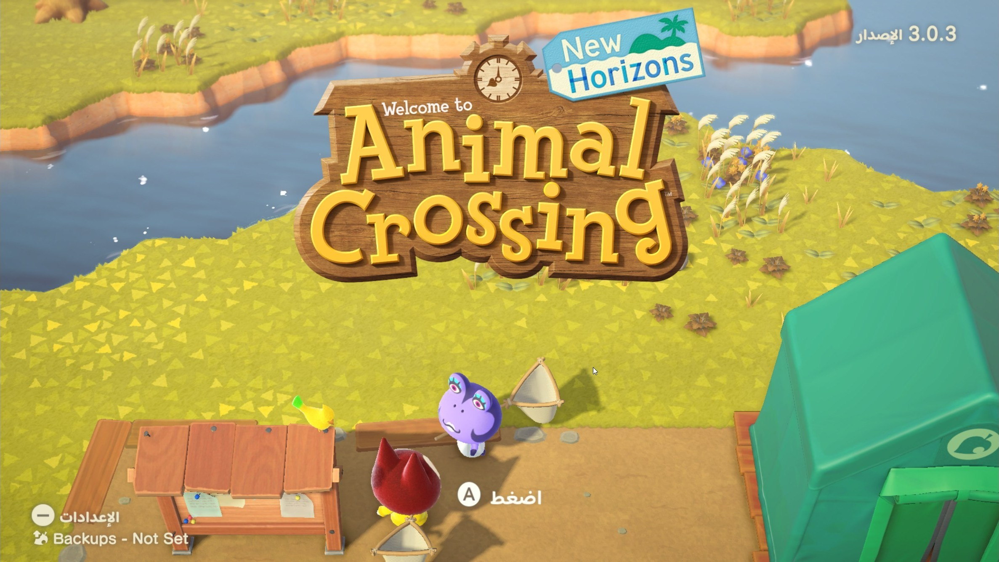
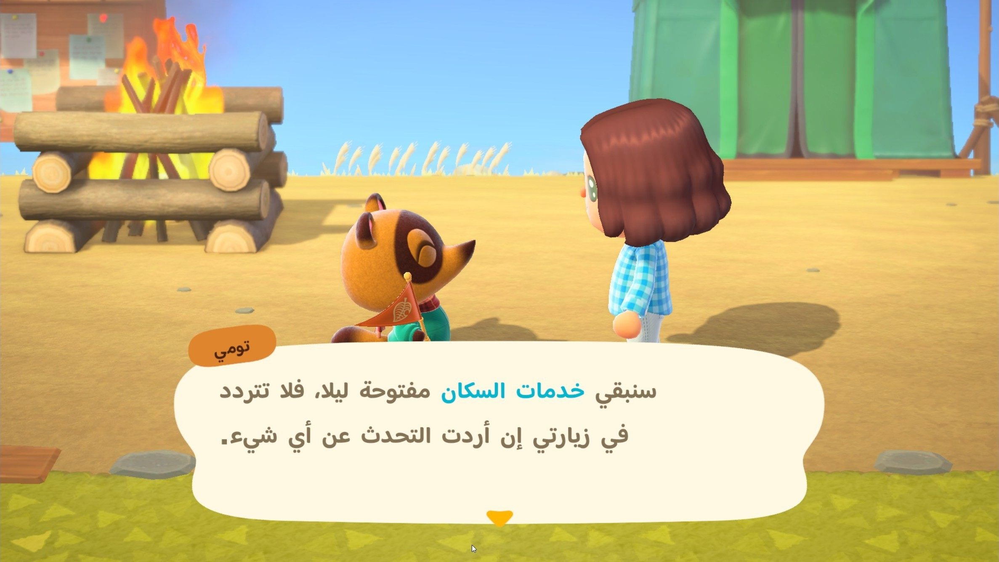
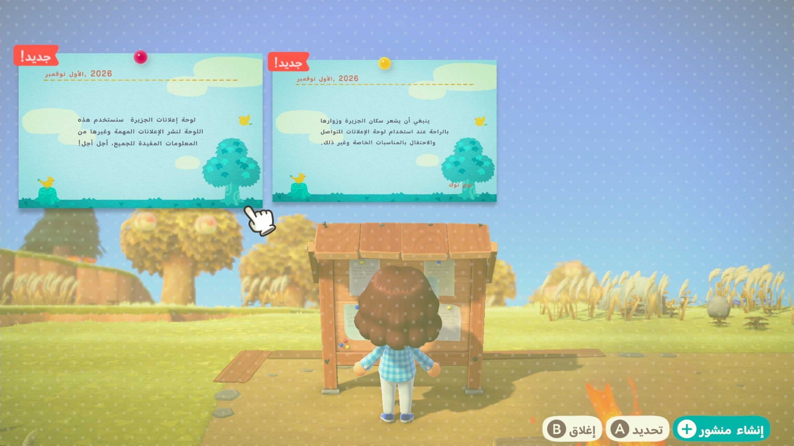
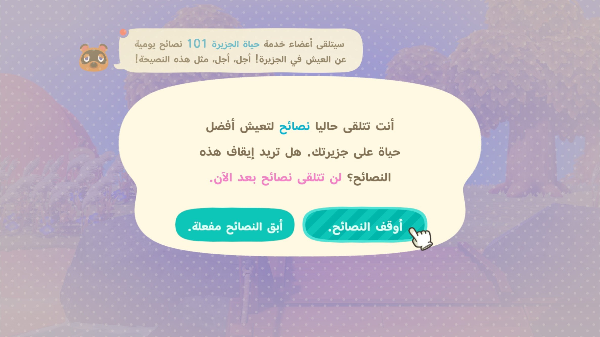
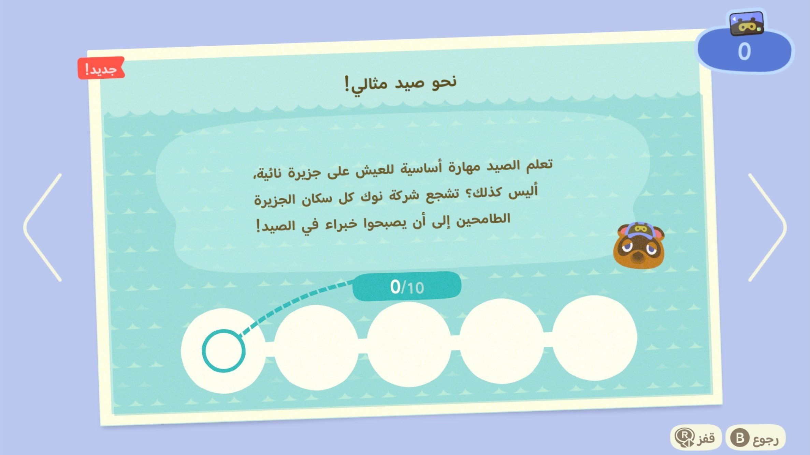

# تعريب Animal Crossing: New Horizons | Animal Crossing: New Horizons Arabic

تعريب كامل لـ Animal Crossing: New Horizons على نينتندو سويتش (الإصدار 3.0.3): حوارات السكان والشخصيات، القوائم، الأغراض والأثاث والملابس، الرسائل، لوحة الإعلانات، ونوك فون. التعريب يحل محل الإنجليزية الأمريكية.

## اللي تحتاجه

1. اللعبة مع **التحديث 3.0.3**.
2. لغة النظام: **English US**.

## التثبيت على Ryujinx أو Eden أو Yuzu

1. حمّل `AnimalCrossingNH-Arabic-Emulator.zip` من [Releases](../../releases/latest) وفك ضغطه.
2. في المحاكي: كليك يمين على اللعبة، ثم:
   - **Ryujinx:** اختر Open Mods Directory
   - **Eden / Yuzu:** اختر Open Mod Data Location
3. اسحب مجلد `ArabicTranslation` إلى المجلد اللي انفتح (يشتغل سواء المحاكي محمول portable أو مثبّت عادي).
4. شغّل اللعبة.

## التثبيت على سويتش حقيقي (Atmosphere)

1. حمّل `AnimalCrossingNH-Arabic-SwitchDevice.zip` وفك ضغطه.
2. انسخ مجلد `atmosphere` إلى أول بطاقة الذاكرة (SD) ووافق على الدمج.

## الإزالة

احذف مجلد `ArabicTranslation` (أو على السويتش المجلد `01006F8002326000` داخل `atmosphere\contents`). ما يتعدّل أي ملف أصلي من ملفات اللعبة.

| | |
|---|---|
|  |  |
|  |  |

---

## English

Complete Arabic translation of Animal Crossing: New Horizons on Nintendo Switch (version 3.0.3): villager and
character dialogue, menus, items, furniture and clothing, letters, the bulletin board and the NookPhone. The Arabic
replaces US English.

### What you need

1. The game with **update 3.0.3**.
2. System language: **English (US)**.

### Install on Ryujinx, Eden or Yuzu

1. Download `AnimalCrossingNH-Arabic-Emulator.zip` from [Releases](../../releases/latest) and extract it.
2. In the emulator, right-click the game, then:
   - **Ryujinx:** Open Mods Directory
   - **Eden / Yuzu:** Open Mod Data Location
3. Drag the `ArabicTranslation` folder into the folder that opens (works for portable and normal emulator installs).
4. Start the game.

### Install on a real Switch (Atmosphere)

1. Download `AnimalCrossingNH-Arabic-SwitchDevice.zip` and extract it.
2. Copy the `atmosphere` folder to the root of the SD card and accept the merge.

### Uninstall

Delete the `ArabicTranslation` folder (on Switch: the `01006F8002326000` folder inside `atmosphere\contents`). No
original game file is changed.

All my translations: https://iosamai.com
